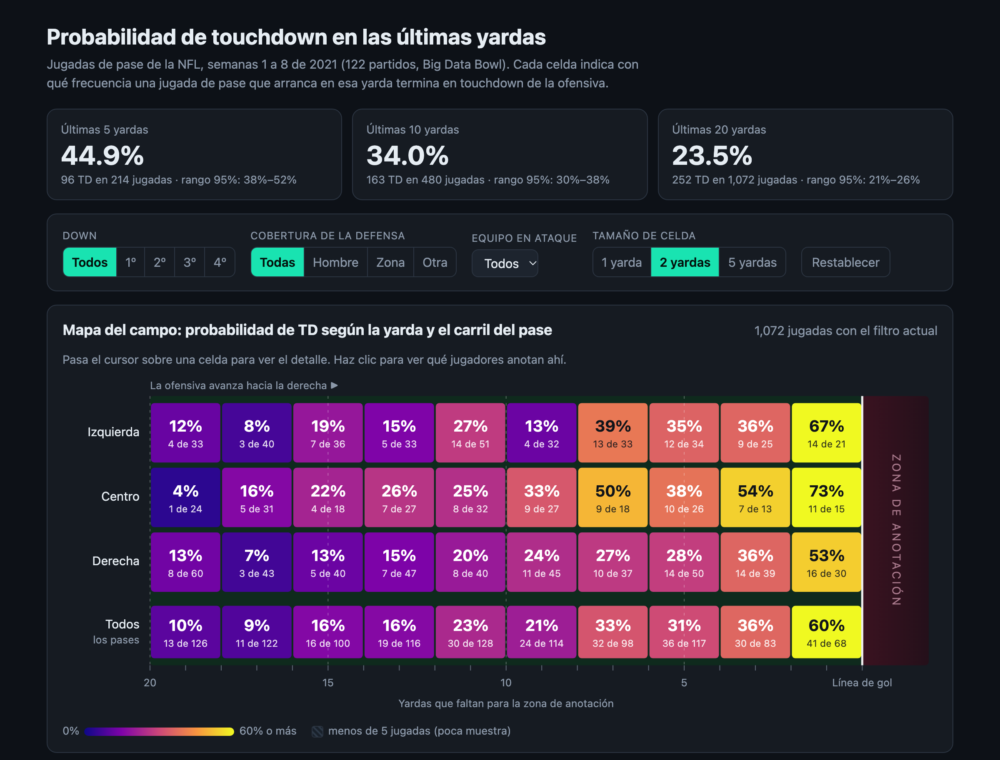
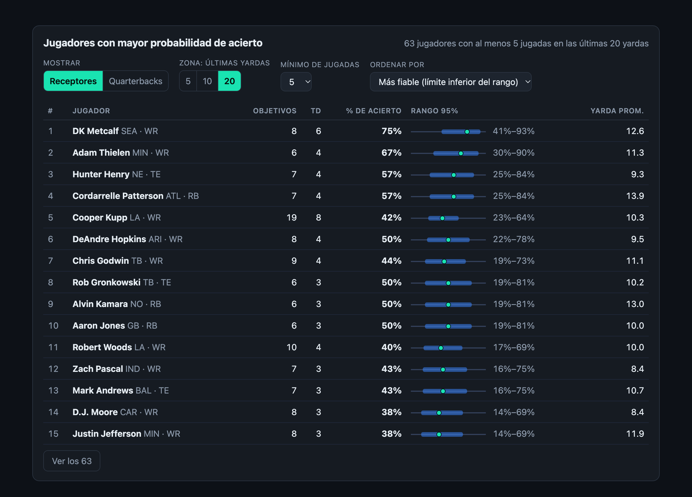

# KANSASCITYDATES: probabilidad de touchdown en las últimas yardas

Mapa interactivo del campo que muestra desde qué yarda y por qué carril es más probable que un pase termine en touchdown (TD), y qué receptores y quarterbacks lo convierten con más frecuencia. Usa las jugadas de pase de las semanas 1 a 8 de 2021 del NFL Big Data Bowl (datos de NFL Next Gen Stats y Pro Football Focus).



## Hallazgo

**El touchdown se decide en las últimas 5 yardas.** Un pase que arranca ahí termina en TD el 44.9% de las veces (96 de 214). Entre las yardas 6 y 10 baja a 25.2% (67 de 266), y entre la 11 y la 20 a 15.0% (89 de 592). La diferencia entre los tres tramos es clara (chi-cuadrada, p < 0.001).

Hay además dos indicios que conviene confirmar con más semanas de datos:

- **El centro del campo rinde más en las últimas 10 yardas.** Los pases por el centro terminan en TD el 46.5% de las veces (46 de 99), contra 35.9% por la izquierda (52 de 145) y 32.3% por la derecha (65 de 201). La diferencia queda en el límite de lo concluyente (p = 0.056).
- **La cobertura en zona permite menos TD que la de hombre entre las yardas 11 y 20.** Con zona, 11.5% (36 de 312). Con hombre, 20.6% (39 de 189). Ajustando por la yarda exacta, la razón de momios es 0.55 (IC 95%: 0.33 a 0.93), es decir, 45% menos momios de TD con zona. En las últimas 10 yardas no hay diferencia. Sin ajustar, la zona parece peor en todo el campo porque se usa sobre todo lejos de la línea de gol: es el 53% de las jugadas entre las yardas 11 y 20 y solo el 3% en las últimas 5.

Entre downs no se ve una diferencia clara (p = 0.37 en las últimas 10 yardas).

**Jugadores con más acierto** (últimas 20 yardas, mínimo 5 jugadas, ordenados por el límite inferior del rango de 95%). Entre los receptores: DK Metcalf (6 TD en 8 objetivos), Adam Thielen (4 en 6), Hunter Henry (4 en 7) y Cordarrelle Patterson (4 en 7). Cooper Kupp es el de mayor volumen, con 8 TD en 19 objetivos (42%). Entre los quarterbacks: Russell Wilson (7 TD en 10 jugadas de pase) y Jameis Winston (11 en 23). Son muestras pequeñas: solo 63 receptores llegan a 5 objetivos y los rangos son amplios (el de Metcalf va de 41% a 93%).

## Para quién es

Para quien toma decisiones de juego en la zona roja y para quien las analiza:

- **Coordinadores ofensivos:** ver desde qué yarda y por qué carril anotan más los pases, y qué receptores y quarterbacks convierten mejor.
- **Coordinadores defensivos:** ver en qué tramo y por qué carril se concede más, y comparar coberturas de hombre y de zona.
- **Analistas y aficionados:** explorar los datos con filtros, sin escribir código.

## Cómo verlo

- **En la app publicada:** la página de inicio es el mapa. No hay que hacer nada más.
- **En tu computadora, sin instalar nada:** abre `mapa_touchdown.html` con doble clic. Es un solo archivo y no necesita internet.
- **En tu computadora, la app completa**, con el entorno ya instalado (`sh .hackathon/setup.sh`). En dos terminales:

  ```bash
  .venv/bin/uvicorn backend.main:app --reload   # API en el puerto 8000
  cd dashboard && npm run dev                    # app en http://localhost:5173
  ```

  Abre `http://localhost:5173` (no `127.0.0.1`). Si `npm` no está en tu PATH, usa el Node del proyecto: `export PATH="$PWD/.hackathon/.tools/node/bin:$PATH"`.

Cómo usarlo:

1. Pasa el cursor sobre una celda para ver el detalle (TD, jugadas, rango de 95% y quién anotó ahí). Haz clic en la celda para filtrar la tabla de jugadores. Haz clic en un jugador para ver sus jugadas como puntos sobre el campo.
2. Filtra por down, cobertura de la defensa y equipo en ataque. Cambia el tamaño de celda (1, 2 o 5 yardas), alterna entre receptores y quarterbacks, y elige la zona (últimas 5, 10 o 20 yardas), el mínimo de jugadas y el orden de la tabla.



El backend calcula el mapa con pandas la primera vez que se pide y lo guarda en memoria, sin escribir archivos. Para regenerar la copia estática `mapa_touchdown.html`:

```bash
.venv/bin/python -m backend.mapa_touchdown
```

Opciones: `--yardas 25` cambia cuántas yardas finales se muestran (de 5 a 30) y `--salida ruta.html` cambia el archivo de salida.

## Cómo se calculó

- **Base:** 8,557 jugadas de pase (dropbacks) de 122 partidos. De ellas, 1,182 empiezan en las últimas 20 yardas. Se excluyen 35 intentos de conversión de 2 puntos y 75 jugadas anuladas por penalización (No Play). Quedan 1,072 jugadas con 252 TD (238 pases completos y 14 scrambles).
- **Yarda:** yardas que faltan para la zona de anotación al empezar la jugada, calculadas con `yardlineSide`, `yardlineNumber` y el equipo en posesión.
- **Touchdown:** los datos no traen una columna de TD. Se detecta en `playDescription` y cuenta solo si es un pase completo o un scramble que llega a la línea de gol. Quedan fuera los TD de la defensa (intercepciones y fumbles devueltos), los anulados por penalización y los revertidos por replay. La detección se validó con el marcador: en toda la muestra, de 356 TD con una jugada siguiente registrada, en 355 el marcador del equipo sube al menos 6 puntos.
- **Carril:** izquierda, centro o derecha según la dirección del pase en la descripción, desde el punto de vista de la ofensiva. Los sacks y los pases sin dirección solo cuentan en "Todos los pases".
- **Receptor:** el nombre abreviado de la descripción (`C.Godwin`) se cruza con los jugadores ofensivos de esa jugada en los datos de PFF. Los 238 TD por pase quedaron asignados a un receptor.
- **Acierto de un jugador:** en receptores, TD entre objetivos. En quarterbacks, TD (de pase o scramble) entre jugadas de pase.
- **Rangos:** intervalo de Wilson al 95%. Las celdas con menos de 5 jugadas aparecen rayadas y sin porcentaje.

## Límites

- Solo hay jugadas de pase. Es la probabilidad de TD cuando el equipo pasa, no la de anotar desde esa yarda.
- Son 8 semanas de una temporada. Las celdas y los jugadores tienen pocas jugadas, por eso se muestran los rangos.
- No se usaron los datos de tracking del Big Data Bowl, así que no se conoce la posición exacta del balón. El carril sale de la descripción de la jugada.
- Se revisaron varios cortes (yarda, carril, down y cobertura) sin corregir por comparaciones múltiples. Solo la caída de la probabilidad con la distancia es contundente. Lo demás son indicios.
- Las coberturas se agrupan como las entrega PFF: "Otra" incluye Red Zone, Goal Line y Bracket. Compara siempre dentro del mismo tramo de yardas.

## Datos y estructura

- `data/`: archivos del Big Data Bowl (`plays`, `games`, `players` y `pffScoutingData`). Van en la entrega, pero no están en el repositorio de GitHub, que es público.
- `backend/main.py`: API FastAPI con `GET /health` y `GET /api/mapa-touchdown`, que devuelve el mapa.
- `backend/mapa_touchdown.py`: lee los CSV con pandas, detecta los TD y genera el HTML del mapa.
- `backend/mapa_touchdown.plantilla.html`: interfaz del mapa en HTML, CSS y JavaScript, sin librerías externas.
- `dashboard/src/App.tsx`: pantalla de inicio de la app. Incrusta el mapa con una ruta relativa (`api/mapa-touchdown`) y ajusta el marco a su alto. `dashboard/vite.config.ts` reenvía `/api` al backend en desarrollo.
- `mapa_touchdown.html`: copia estática del mismo mapa (250 KB). `captura-mapa.png` y `captura-jugadores.png` son las imágenes de este README.
- Stack: el del evento (FastAPI, React, Vite, Tailwind, pandas y numpy). No se agregaron dependencias.
